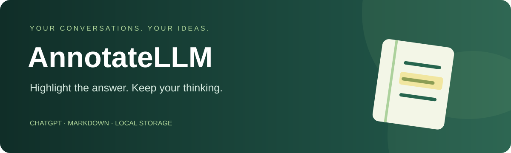
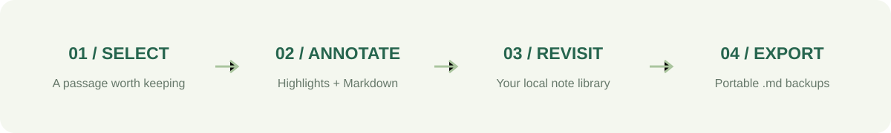
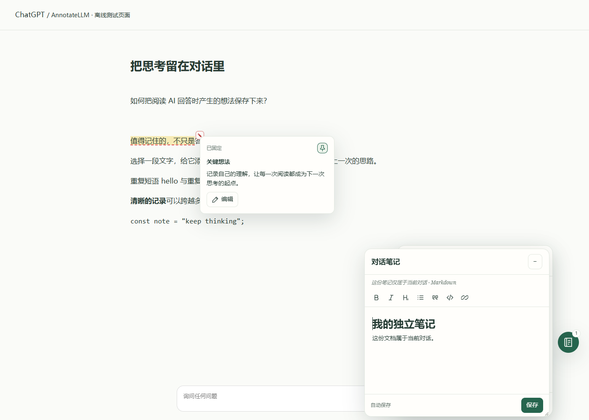
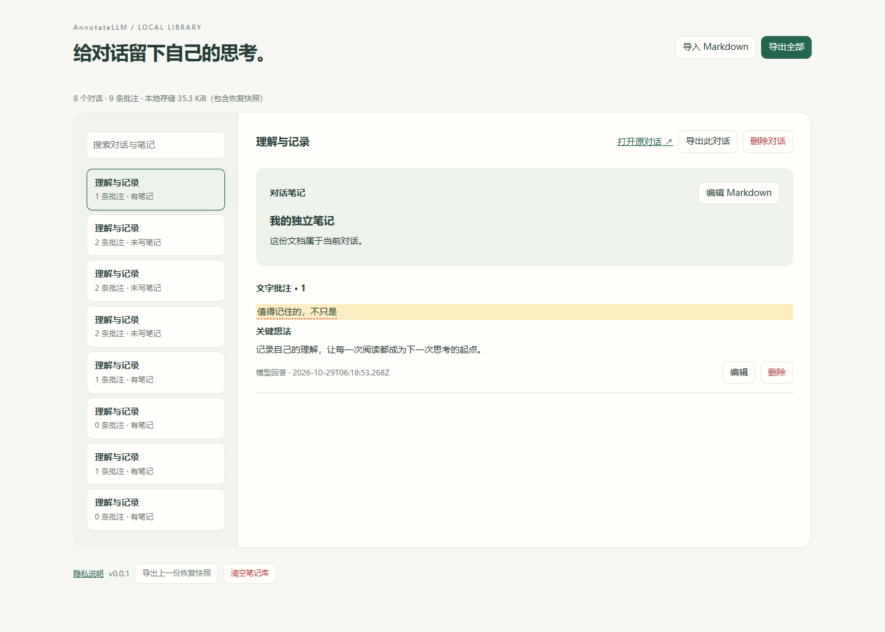

<p align="center"><a href="README.md">简体中文</a> · <a href="README_EN.md">English</a> · <a href="README_KR.md">한국어</a></p>

<p align="center"></p>

<p align="center"> <a href="LICENSE"></a>  </p>

# Keep your thinking beside the conversation.

**AnnotateLLM** brings highlights, Markdown annotations and conversation notes to ChatGPT on the web. Keep selected passages and ideas in your current browser, revisit them, and export Markdown backups. This version makes no model calls and offers no cloud sync or paid hosting.

## Features

| Read | Think | Revisit |
| :--- | :--- | :--- |
| 🟡 Four highlight colors | ✍️ Live Markdown editing | 🗂️ Local library, search and filters |
| 📍 Context and message fingerprint anchoring | 📌 Draggable notes and pinned previews | 📄 Full-library or single-chat export |
| 🌗 Light/dark and narrow layouts | 📝 Resizable conversation sticky notes | 🛟 Import preview, conflicts and recovery snapshot |

Choose **中文 / English / 한국어** in the popup. Your notes and excerpts stay in their original language.



## Preview

These screenshots use fictional conversations in an isolated browser fixture, not a real account.



<details><summary>Open the local library preview</summary>



</details>

## Install

1. Download and extract the browser ZIP from [v0.0.1](https://github.com/HeCaoMin/AnnotateLLM/releases/tag/v0.0.1), or build from source below.
2. Open chrome://extensions or edge://extensions and enable Developer mode.
3. Choose Load unpacked and select the extracted folder, or **dist/dialog-notes** after building. Do not load extension directly.
4. Open AnnotateLLM from the toolbar, read the privacy notice and enable annotations.
5. Refresh ChatGPT, open a saved conversation with a stable URL, and select message text.

Export a backup before updating. Replace files in the original loaded folder, reload the extension and refresh ChatGPT. Uninstalling clears local data.

## Privacy and limits

- Saved conversations on chatgpt.com only. Other LLM sites, shared pages, temporary chats and incognito are unsupported.
- Stores excerpts, brief context, anchors and notes, not entire chats. No analytics, automatic uploads or sync.
- No additional password encryption for storage or exports. Data belongs to the current browser profile.
- Library limit: 2 MiB plus a recovery snapshot. Notes: 100,000 characters each; excerpts: 20,000 characters.
- Overlapping annotations and selections spanning messages are unsupported. Changed or unloaded text may not resolve; saved records remain available.
- Imports require intact AnnotateLLM metadata. An ordinary Markdown file is not a restorable backup.

Edge regression checks use isolated simulated pages. Real signed-in ChatGPT and Chrome compatibility still need further validation. No extension-store listing yet. See [test scope](docs/TEST-REPORT.md) and [privacy notice](docs/PRIVACY.md).

## Stack and development

<p align="center">     </p>

Node.js 22+ is required. The editor and dependencies are bundled locally, with no remote scripts.

```sh
npm ci
npm run check:publication
npm run check
npm test
npm run build
```

Package on Windows: `pwsh -File scripts/package.ps1`. Output: dist. See [build instructions](docs/RELEASE.md) for external Playwright and browser configuration.

| Directory | Purpose |
| --- | --- |
| extension/ | Page adapter, local storage and three-language UI |
| editor/ | ProseMirror Markdown editor |
| tests/, scripts/ | Synthetic tests, checks, build and packaging |
| docs/ | Format, publication rules and public assets |

## Contribute and license

Read [publication and privacy rules](docs/PUBLISHING.md) before contributing. Use fictional examples in [Issues](https://github.com/HeCaoMin/AnnotateLLM/issues); never attach private chats, backups or credentials.

[MIT License](LICENSE). Third-party components retain their own licenses. AnnotateLLM is independent and is not affiliated with OpenAI.
