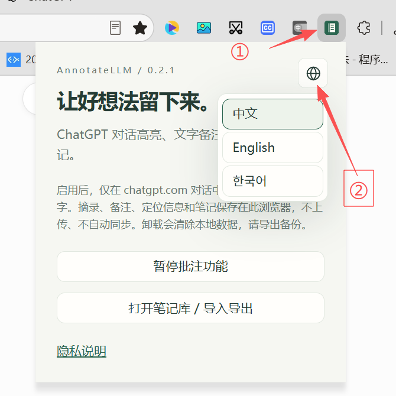
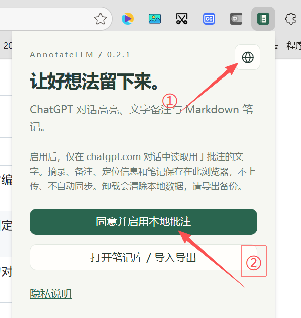
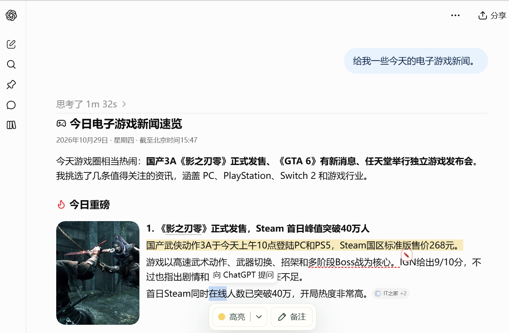
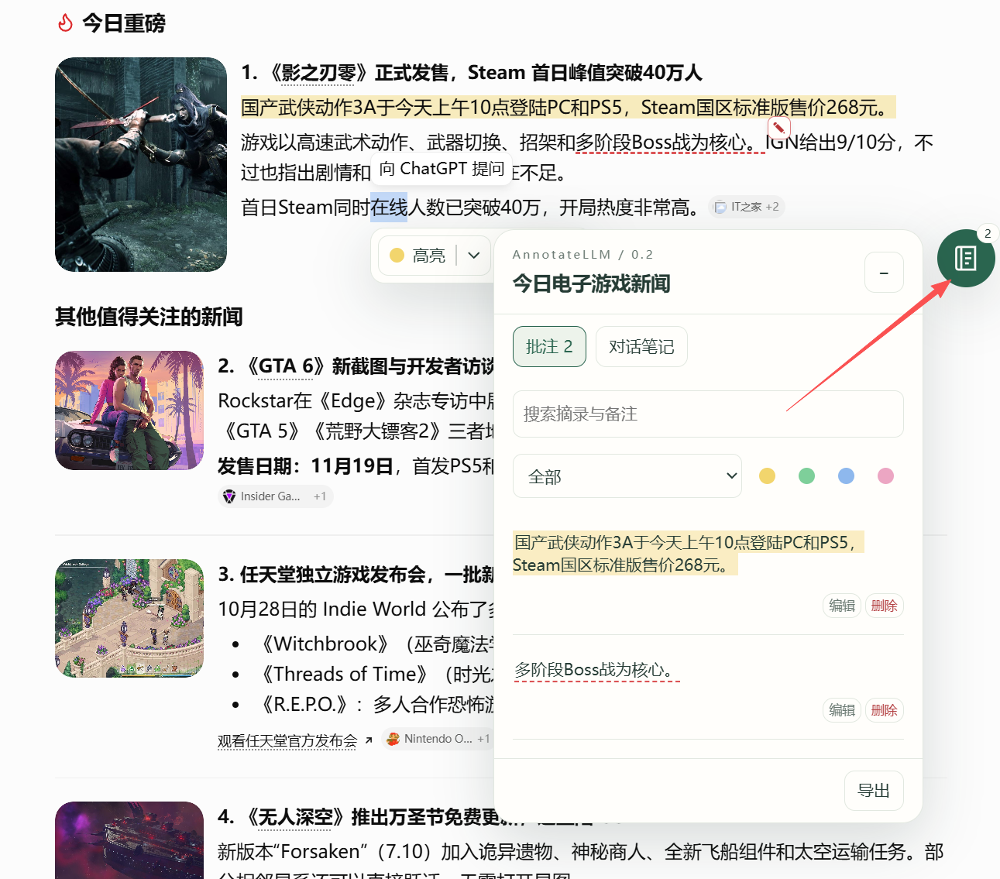

<p align="center"><a href="README.md">简体中文</a> · <a href="README_EN.md">English</a> · <a href="README_KR.md">한국어</a></p>

<p align="center"></p>

<p align="center"> <a href="LICENSE"></a>  </p>

# AnnotateLLM
#### 대화 옆에 나의 생각을 남기세요.

**AnnotateLLM**은 ChatGPT 웹 대화에 하이라이트, Markdown 주석, 독립적인 대화 노트를 추가합니다. 선택한 문장과 생각을 현재 브라우저에 저장하고 다시 읽거나 Markdown으로 내보낼 수 있습니다. 현재 버전은 모델 호출, 클라우드 동기화 또는 유료 호스팅을 제공하지 않습니다.

[설치](#설치) · [기능](#주요-기능) · [데이터 형식](docs/FORMAT.md) · [문제 신고](https://github.com/HeCaoMin/AnnotateLLM/issues)

## 주요 기능

<p align="center"></p>

| 읽기 | 생각 정리 | 다시 보기 |
| :--- | :--- | :--- |
| 🟡 네 가지 하이라이트 색상 | ✍️ 실시간 Markdown 렌더링 및 편집 | 🗂️ 독립 보관함, 검색 및 필터 |
| 📍 발췌문, 문맥 및 메시지 지문으로 위치 확인 | 📌 이동 가능한 주석과 고정 미리보기 | 📄 전체 또는 대화별 내보내기 |
| 🌗 밝은/어두운 테마와 좁은 화면 | 📝 이동 및 크기 조절이 가능한 대화 메모 | 🛟 가져오기 미리보기, 충돌 처리 및 복구 스냅샷 |

팝업에서 **中文 / English / 한국어**를 선택할 수 있습니다. 사용자 노트와 발췌문은 번역하지 않습니다.

<p align="center"></p>

## 설치

1. [v0.0.1](https://github.com/HeCaoMin/AnnotateLLM/releases/tag/v0.0.1)에서 브라우저용 ZIP을 내려받아 압축을 풀거나 아래 명령으로 소스에서 빌드합니다.
2. chrome://extensions 또는 edge://extensions에서 개발자 모드를 켭니다.
3. 압축 해제된 확장 프로그램 로드를 선택하고 압축을 푼 폴더를 지정합니다. 소스 빌드 시 **dist/dialog-notes**를 선택하며 extension을 직접 로드하지 않습니다.
4. 도구 모음의 AnnotateLLM에서 개인정보 안내를 읽고 주석 기능을 켭니다.
5. ChatGPT를 새로고침하고 고정 URL이 있는 저장된 대화에서 메시지 텍스트를 선택합니다.

업데이트 전에 백업을 내보내세요. 원래 로드한 폴더의 파일을 교체하고 확장 프로그램과 ChatGPT를 새로고침하세요. 삭제 후 재설치하면 로컬 데이터가 지워집니다.

## 사용 안내

다음 스크린샷은 실제 페이지를 보여 줍니다. 일부에 표시된 버전 번호는 이전 버전이며 사용 방법 참고용입니다.

1. 설치 후 브라우저 도구 모음의 확장 프로그램을 클릭하고 “동의하고 로컬 주석 사용”을 선택합니다.

<p align="center"></p>

2. ChatGPT 대화에서 텍스트를 선택하여 하이라이트 또는 주석을 추가합니다.

<p align="center"></p>

3. 페이지의 떠 있는 버튼을 클릭하여 현재 대화의 하이라이트와 주석을 분류해 볼 수 있습니다. “대화 노트”에서 실시간으로 렌더링되는 Markdown 노트를 작성할 수도 있습니다.

<p align="center"></p>

<details><summary>노트 보관함 보기</summary>

<p align="center"></p>

</details>

## 개인정보 및 제한

- chatgpt.com의 저장된 일반 대화만 지원합니다. 다른 LLM 사이트, 공유 페이지, 임시 대화 및 시크릿 모드는 지원하지 않습니다.
- 발췌문, 짧은 문맥, 위치 정보 및 노트만 저장하며 전체 대화는 저장하지 않습니다. 분석 추적, 자동 업로드 및 동기화가 없습니다.
- 저장소와 내보낸 파일에 추가 비밀번호 암호화를 제공하지 않습니다. 데이터는 현재 브라우저 프로필에 저장됩니다.
- 문서 한도는 2 MiB이며 복구 스냅샷을 별도로 보관합니다. 노트는 각각 100,000자, 선택한 텍스트는 20,000자까지 지원합니다.
- 겹치는 주석과 여러 메시지에 걸친 선택은 지원하지 않습니다. 원문이 변경되거나 로드되지 않으면 위치를 찾지 못할 수 있지만 저장된 기록은 남습니다.
- 가져오기에는 AnnotateLLM 메타데이터가 온전한 백업이 필요합니다. 일반 Markdown 파일은 복구용 백업이 아닙니다.

Edge 검증은 격리된 합성 페이지에서 수행했습니다. 실제 로그인된 ChatGPT 및 Chrome 호환성은 추가 검증이 필요하며 확장 프로그램 스토어에는 등록되지 않았습니다. [테스트 범위](docs/TEST-REPORT.md)와 [개인정보 안내](docs/PRIVACY.md)를 참고하세요.

## 기술 스택 및 개발

<p align="center">     </p>

Node.js 22 이상이 필요합니다. 편집기와 의존성은 로컬로 번들링하며 원격 스크립트를 로드하지 않습니다.

```sh
npm ci
npm run check:publication
npm run check
npm test
npm run build
```

Windows 패키징: `pwsh -File scripts/package.ps1`. 결과는 dist에 생성됩니다. 외부 Playwright 및 브라우저 설정은 [빌드 안내](docs/RELEASE.md)를 참고하세요.

| 디렉터리 | 용도 |
| --- | --- |
| extension/ | 페이지 어댑터, 로컬 저장소 및 다국어 UI |
| editor/ | ProseMirror Markdown 편집기 |
| tests/, scripts/ | 합성 테스트, 검사, 빌드 및 패키징 |
| docs/ | 데이터 형식, 공개 규칙 및 이미지 |

## 개발 계획

- Gemini, DeepSeek, GLM, Kimi, Qwen 웹 버전 지원을 추가할 계획입니다.
- WebDAV를 통한 하이라이트와 주석 저장 및 기기 간 동기화 기능을 추가할 계획입니다.

## 후원하기

<p align="center"></p>

## 기여 및 라이선스

기여 전에 [공개 및 개인정보 규칙](docs/PUBLISHING.md)을 읽어주세요. [Issues](https://github.com/HeCaoMin/AnnotateLLM/issues)에는 가상 예제만 사용하고 개인 대화, 백업 또는 인증 정보를 첨부하지 마세요.

[MIT License](LICENSE)를 적용합니다. 타사 구성 요소는 각각의 라이선스를 유지합니다. AnnotateLLM은 OpenAI와 제휴하지 않은 독립 프로젝트입니다.
